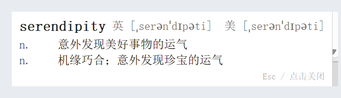

# WordLens · 划词速查

> 复制英文，右下角自动弹出释义或翻译。Windows 小工具，常驻托盘，不打断你正在做的事。

在浏览器里读英文网页时，最顺手的动作就是**选中一段文字 → Ctrl+C**。WordLens 盯住剪贴板：复制的是单个单词，就查词典（音标 + 词性 + 中文释义）；复制的是句子，就整句翻译。结果出现在屏幕右下角，**不抢焦点**，按 `Esc` 或点一下即关闭，12 秒后自动隐藏。



## 特性

- **零快捷键**：不用记热键，复制即触发
- **单词 / 句子自动分流**：单词走有道词典接口，句子走 MyMemory 翻译
- **不打断当前窗口**：弹出后主动把焦点还给原来的前台窗口
- **常驻托盘**：右键托盘图标可看「关于」或退出
- **高 DPI 适配**：开启 DPI 感知并按缩放比例换算换行宽度，150%/200% 缩放下文字不会挤成一列
- **无账号、无数据库、不存历史**：只发请求，不落盘

## 下载

- **直接用**：[Releases · v1.0.0](https://github.com/HeyYeahYeahYeah/WordLens/releases/latest) 下载 `WordLens.exe`，双击运行，无需安装 Python
- **源码运行**：

```powershell
git clone https://github.com/HeyYeahYeahYeah/WordLens.git
cd WordLens
pip install -r requirements.txt
python main.py
```

## 快速开始

需要 Python 3.9+（Windows）：

```powershell
pip install -r requirements.txt
python main.py
```

启动后右下角托盘出现一个圆形 "W" 图标，程序开始监听剪贴板。随便复制一个英文单词试试。

想先看界面效果、又不想复制东西的话，可以跑演示模式（不建托盘、不监听剪贴板，只弹一张示例卡片）：

```powershell
python main.py --demo
```

## 打包成单文件 exe

```powershell
pip install pyinstaller
pyinstaller --onefile --noconsole --name WordLens main.py
```

产物在 `dist\WordLens.exe`，可直接发给别人用（无需安装 Python）。

> 打包环境注意：如果 Python 是精简构建（不带 tkinter），`--onefile` 会报 `No module named 'tkinter'`。请换用带 Tcl/Tk 的完整 Python 环境。

## 工作原理

| 模块 | 职责 |
| --- | --- |
| `core.py` | 纯逻辑，无 GUI 依赖：`is_word()` 判定单词；`fetch_word()` 走有道 `dict.youdao.com/jsonapi`；`fetch_translate()` 走 MyMemory，`en → zh-CN` |
| `main.py` | 每 0.3s 轮询剪贴板 → 分流 → tkinter 无边框悬浮窗渲染 → 托盘（pystray） |

两条数据源都是免 key 的公开接口，因此：

- 可能被限流（尤其 MyMemory 免费额度），失败时窗口提示"翻译失败，请检查网络"
- 接口字段可能变动，`core.py` 里的解析做了容错，但极端情况下会拿不到释义

## 已知限制

- 仅支持 Windows（依赖 `ctypes.windll` 还焦点、pystray 托盘）
- 只处理**英文 → 中文**方向
- 无发音、无历史记录、无词典缓存
- 同一个词反复复制不会重复弹出（去重）

## 目录结构

```
wordlens/
├── main.py            # 入口：托盘 + 剪贴板监听 + 悬浮窗
├── core.py            # 查询与解析逻辑（可单独测试）
├── requirements.txt
├── build.ps1          # 一键打包
├── tests/
│   └── test_core.py   # 单元测试（加 --live 跑真实接口）
└── docs/
    └── DEV_NOTES.md   # 开发笔记：踩过的坑
```

## 测试

```powershell
python tests/test_core.py           # 离线单元测试
python tests/test_core.py --live    # 附带真实网络请求
```

## 隐私

程序不收集、不上传任何内容；你复制的内容只会在判定后发给有道 / MyMemory 其中一个请求，用于查词或翻译。

## License

MIT
